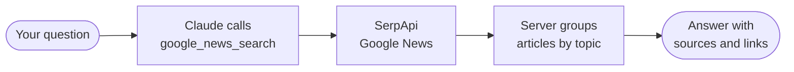

<div align="center">


# Google News MCP Server

### Live news for your AI assistant.

Ask Claude about today's news. It searches Google News and answers with real articles, sorted by topic.

<a href="https://www.npmjs.com/package/@chanmeng666/google-news-server"></a> <a href="https://serpapi.com/"></a> <a href="docs/overview.md"></a>

</div>

<br>

<a href="https://www.npmjs.com/package/@chanmeng666/google-news-server"></a>

<br>

https://github.com/user-attachments/assets/1cc71c27-f840-4c94-9ab5-460d84ba4779

<br>

## Try it

Get a key from [SerpApi](https://serpapi.com/), then add this to `claude_desktop_config.json`:

```json
{
  "mcpServers": {
    "google-news": {
      "command": "npx",
      "args": ["-y", "@chanmeng666/google-news-server"],
      "env": { "SERP_API_KEY": "your-api-key" }
    }
  }
}
```

Restart Claude and ask:

> *What happened in AI this week?*

## Why use it

- **One tool to learn.** `google_news_search` takes a query and returns each article's title, source, date, summary and link.
- **Sorted before it reaches the model.** Articles arrive grouped as AI & Technology, Business, Science & Research, Healthcare or General, newest first.
- **Any country.** Set the `gl` and `hl` codes to search another country's news or another language.



## For your agent

This page is all a person needs. Everything else is written for agents: clone the repo and point yours at [`llms.txt`](llms.txt) and [`docs/overview.md`](docs/overview.md).

```bash
git clone https://github.com/ChanMeng666/server-google-news
```

<sub>[Full overview](docs/overview.md) · [Changelog](CHANGELOG.md) · [Contributing](CONTRIBUTING.md) · [Security](SECURITY.md) · [MIT](LICENSE)</sub>

<sub>See also: [Google Jobs MCP Server](https://github.com/ChanMeng666/server-google-jobs). Built by [Chan Meng](https://github.com/ChanMeng666).</sub>
